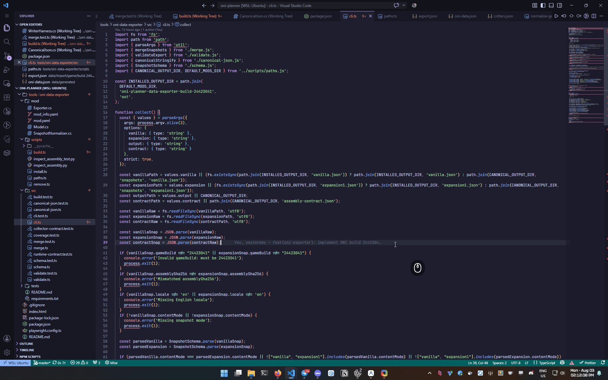

# Window Switcher

Window-Switcher offers hotkeys for quickly switching windows on Windows OS:

1. `Alt+Backtick`: switch between windows belonging to the foreground app using a responsive visual grid.

   Hold Alt and press Backtick repeatedly to navigate through the visual preview grid. Release Alt to activate the selected window, hold Shift (`Alt+Shift+` `) to navigate backward, or press Escape to cancel switching.

   The visual grid displays cached, aspect-correct window previews along with app icons and readable titles. When switching between more than ten windows, selection seamlessly pages in 10-window layouts.



2. ```Alt+Tab```: switch between apps. (disabled by default)


**💡 Hold down the `Alt` key and tap the ``` `(Backtick)/Tab ``` key to cycle through windows/apps, Press ```Alt + `(Backtick)/Tab``` and release both keys to switch to the last active window/app.**

## Installation

1. **Download:** Visit the [Github Release](https://github.com/sigoden/windows-switcher/releases) and download the `windows-switcher.zip` file.
2. **Extract:** Unzip the downloaded file and extract the `window-switcher.exe` to your preferred location.
3. **Launch:** `window-switcher.exe` is a standalone executable, no installation is required, just double-click the file to run it.

For the tech-savvy, here's a one-liner to automate the installation:
```ps1
iwr -useb https://raw.githubusercontent.com/sigoden/window-switcher/main/install.ps1 | iex
```

## Configuration

Window-Switcher offers various customization options to tailor its behavior to your preferences. You can define custom keyboard shortcuts, enable or disable specific features, and fine-tune settings through a configuration file.

To personalize Window-Switcher, you'll need a configuration file named `window-switcher.ini`. This file should be placed in the same directory as the `window-switcher.exe` file. Once you've made changes to the configuration, make sure to restart Window-Switcher so your new settings can take effect.

Here is the default configuration:

```ini
# Whether to show the notification-area icon.
trayicon = yes

[switch-windows]
# Switch between windows belonging to the foreground app.
hotkey = alt+`
blacklist =
ignore_minimal = no
thumbnail_preview = yes
enable_quick_actions = yes
only_current_desktop = auto

[switch-apps]
# Optional app-level switcher.
enable = no
hotkey = alt+tab
ignore_minimal = no
override_icons =
only_current_desktop = auto

[log]
level = info
path =
```

## Running as Administrator (Optional)

The window-switcher works in standard user mode. But only the window-switcher running in administrator mode can manage applications running in administrator mode.

**Important:** If you enable the startup option while running in standard user mode, it will launch in standard mode upon system reboot. To ensure startup with admin privileges, launch the window-switcher as administrator first before enabling startup.

## License

Copyright (c) 2023-2025 window-switcher developers.

window-switcher is made available under the terms of the MIT License, at your option.

See the LICENSE files for license details.
